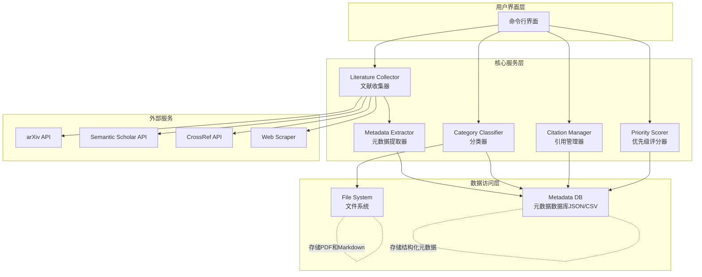

# Design Document: Literature Collection System

## Overview

本设计文档描述了一个用于 lowalt3d 项目的文献收集与管理系统。该系统通过自动化的方式搜索、下载、分类和管理与玻璃/材质识别相关的学术文献，帮助研究人员快速获取和组织相关资源。

系统采用模块化设计，包含文献搜索、元数据提取、分类管理、引用生成和优先级排序等核心功能。所有数据以结构化格式存储，支持检索和更新。

## Architecture



### 架构说明

1. **用户界面层**: 提供命令行工具供研究人员执行搜索、分类、导出等操作
2. **核心服务层**: 包含五个主要模块，每个模块负责特定功能
3. **数据访问层**: 管理文件系统和结构化数据存储
4. **外部服务**: 集成多个学术数据库API进行文献搜索和元数据获取

## Components and Interfaces

### 1. Literature Collector (文献收集器)

**职责**: 搜索和下载学术文献

**接口**:
```python
class LiteratureCollector:
    def search(
        keywords: List[str],
        sources: List[str] = None,
        year_range: Tuple[int, int] = None,
        max_results: int = 100
    ) -> List[Paper]
    
    def download_pdf(
        paper: Paper,
        output_dir: str
    ) -> bool
    
    def batch_collect(
        query_config: Dict
    ) -> CollectionResult
```

**依赖的外部API**:
- **arXiv API**: 搜索预印本文献
- **Semantic Scholar API**: 获取引用信息和影响力指标
- **CrossRef API**: 获取DOI元数据
- **Web Scraper**: 从CVPR、ISPRS等会议网站爬取

### 2. Metadata Extractor (元数据提取器)

**职责**: 从文献源和PDF文件中提取结构化元数据

**接口**:
```python
class MetadataExtractor:
    def extract_from_api(
        api_response: Dict
    ) -> PaperMetadata
    
    def extract_from_pdf(
        pdf_path: str
    ) -> PaperMetadata
    
    def enhance_metadata(
        metadata: PaperMetadata,
        semantic_scholar: bool = True
    ) -> PaperMetadata
```

**元数据schema**:
```json
{
  "id": "unique_paper_id",
  "title": "Paper Title",
  "authors": ["Author 1", "Author 2"],
  "year": 2024,
  "venue": "CVPR",
  "doi": "10.1234/example",
  "arxiv_id": "2401.12345",
  "abstract": "Abstract text...",
  "keywords": ["keyword1", "keyword2"],
  "pdf_path": "papers/facade-seg/paper.pdf",
  "url": "https://...",
  "citation_count": 15,
  "relevance_score": 18.5,
  "categories": ["facade-seg", "window-detection"],
  "added_date": "2026-08-03",
  "last_updated": "2026-08-03"
}
```

### 3. Category Classifier (分类器)

**职责**: 根据文献内容将其分类到预定义的主题文件夹

**接口**:
```python
class CategoryClassifier:
    def classify(
        metadata: PaperMetadata
    ) -> List[Category]
    
    def organize_files(
        paper: Paper,
        categories: List[Category]
    ) -> None
    
    def generate_category_readme(
        category: Category
    ) -> None
```

**支持的分类类别**:
```python
CATEGORIES = {
    "facade-seg": "立面分割与窗检测 (Facade Segmentation & Window Detection)",
    "zero-shot": "零样本学习与开放词汇 (Zero-shot & Open Vocabulary)",
    "3dgs-material": "3D高斯材质学习 (3D Gaussian Material Learning)",
    "synthetic-data": "合成数据与数据增强 (Synthetic Data & Augmentation)",
    "uav-processing": "航拍图像处理 (UAV Image Processing)",
    "glass-detection": "玻璃表面检测 (Glass Surface Detection)",
    "multi-view": "多视角一致性 (Multi-view Consistency)"
}
```

**分类逻辑**: 基于关键词匹配和标题/摘要的文本分析
```python
CATEGORY_KEYWORDS = {
    "facade-seg": ["facade", "building", "segmentation", "window detection", "wall", "architectural"],
    "zero-shot": ["zero-shot", "open vocabulary", "CLIP", "grounding", "SAM"],
    "3dgs-material": ["3D Gaussian", "3DGS", "material", "PGSR", "neural rendering"],
    "synthetic-data": ["synthetic", "simulation", "augmentation", "procedural"],
    "uav-processing": ["UAV", "drone", "aerial", "oblique imagery", "nadir"],
    "glass-detection": ["glass", "transparent", "reflection", "window", "glazing"],
    "multi-view": ["multi-view", "consistency", "cross-view", "view synthesis"]
}
```

### 4. Citation Manager (引用管理器)

**职责**: 生成和管理BibTeX引用

**接口**:
```python
class CitationManager:
    def generate_bibtex(
        metadata: PaperMetadata
    ) -> str
    
    def export_bibliography(
        papers: List[PaperMetadata],
        output_path: str
    ) -> None
    
    def generate_cite_key(
        metadata: PaperMetadata
    ) -> str
```

**BibTeX生成规则**:
- cite key格式: `{first_author_lastname}{year}{first_title_word}`
- 示例: `lin2021rich` (Lin et al., 2021, "Rich Context Aggregation...")
- 处理特殊字符: 移除非ASCII字符，统一小写
- 去重: 如果cite key冲突，添加后缀 `a`, `b`, `c`...

### 5. Priority Scorer (优先级评分器)

**职责**: 根据多个维度计算文献相关性评分

**接口**:
```python
class PriorityScorer:
    def calculate_score(
        metadata: PaperMetadata,
        lowalt3d_context: Dict
    ) -> float
    
    def generate_priority_list(
        papers: List[PaperMetadata],
        top_n: int = 20
    ) -> List[Tuple[PaperMetadata, str]]  # (paper, recommendation)
```

**评分标准**:
```python
def calculate_score(paper: PaperMetadata) -> float:
    # 1. 与lowalt3d管线的契合度 (0-5分)
    pipeline_fit = calculate_pipeline_relevance(paper)
    
    # 2. 方法的可实现性 (0-5分)
    # 基于是否需要新硬件、CUDA编程、数据标注等
    feasibility = calculate_feasibility(paper)
    
    # 3. 引用次数和影响力 (0-5分)
    # 归一化引用次数: log10(citations + 1) 映射到 0-5
    impact = min(5.0, math.log10(paper.citation_count + 1))
    
    # 4. 发表时间新近度 (0-5分)
    # 2024-2026: 5分, 2020-2023: 3-4分, <2020: 0-2分
    recency = calculate_recency(paper.year)
    
    return pipeline_fit + feasibility + impact + recency
```

## Data Models

### Paper (文献对象)
```python
@dataclass
class Paper:
    id: str
    metadata: PaperMetadata
    pdf_path: Optional[str]
    annotation_path: str  # Markdown注释文件路径
    categories: List[Category]
```

### PaperMetadata (文献元数据)
```python
@dataclass
class PaperMetadata:
    title: str
    authors: List[str]
    year: int
    venue: str
    doi: Optional[str]
    arxiv_id: Optional[str]
    abstract: str
    keywords: List[str]
    url: str
    citation_count: int
    relevance_score: float
    added_date: datetime
    last_updated: datetime
```

### Category (分类类别)
```python
@dataclass
class Category:
    id: str  # 例如: "facade-seg"
    name: str  # 例如: "立面分割与窗检测"
    description: str
    keywords: List[str]
    paper_count: int
```

### CollectionResult (收集结果)
```python
@dataclass
class CollectionResult:
    total_found: int
    total_downloaded: int
    failed_downloads: List[Tuple[str, str]]  # (paper_id, reason)
    papers: List[Paper]
```

## File Organization (文件组织结构)

```
docs/literature/
├── README.md                          # 主索引，列出所有文献
├── PRIORITY_LIST.md                   # 优先阅读列表Top 20
├── metadata.json                      # 所有文献的结构化元数据
├── bibliography.bib                   # 所有文献的BibTeX引用
├── update_log.md                      # 更新日志
│
├── by-category/                       # 按主题分类
│   ├── facade-seg/
│   │   ├── README.md
│   │   ├── lin2021_rich_context.pdf
│   │   ├── lin2021_rich_context.md
│   │   └── ...
│   ├── zero-shot/
│   │   ├── README.md
│   │   └── ...
│   ├── 3dgs-material/
│   ├── synthetic-data/
│   ├── uav-processing/
│   ├── glass-detection/
│   └── multi-view/
│
└── by-year/                           # 按年份索引
    ├── 2026/
    ├── 2025/
    ├── 2024/
    └── ...
```

### 注释文件格式 (Markdown)

```markdown
# [Paper Title]

## 基本信息
- **作者**: Author 1, Author 2
- **发表年份**: 2024
- **会议/期刊**: CVPR 2024
- **DOI**: 10.1234/example
- **arXiv**: 2401.12345
- **PDF**: [下载链接](./paper.pdf)

## 中文摘要
[简短的中文摘要，100-200字]

## 核心方法
- 方法1: 描述
- 方法2: 描述
- 关键创新点: ...

## 与lowalt3d的相关性 ★★★★☆
**契合度评分**: 4.5/5

**应用场景**:
1. 立面正射图生成: 可以借鉴其homography校正方法
2. 窗检测: Grounding DINO + SAM2的组合直接适用
3. 集成难度: 低，Python实现，无需CUDA

**实施建议**:
- 优先级: 高
- 预计工作量: 2-3天
- 依赖: transformers, groundingdino, segment-anything-2

## 关键结果
- 在CMP Facade数据集上window IoU=0.85
- 零样本设置下F1=0.78
- [关键图表截图]

## 引用
```bibtex
@inproceedings{lin2021rich,
  title={Rich Context Aggregation with Reflection Prior for Glass Surface Detection},
  author={Lin, Jiaying and Wang, Guodong and Lau, Rynson W.H.},
  booktitle={CVPR},
  year={2021}
}
```
```

## Correctness Properties

*属性（Property）是描述系统在所有有效执行中都应保持的特性或行为的形式化陈述。通过property-based testing，我们可以验证系统在大量随机输入下是否满足这些正确性保证。*

### Property 1: 搜索结果格式一致性
*For any* 有效的关键词列表，搜索操作应该返回符合`PaperMetadata` schema的文献列表，且每个元素都包含必需的字段（title, authors, year, url）

**Validates: Requirements 1.1, 1.3**

### Property 2: 来源过滤正确性
*For any* 指定的文献来源参数，搜索返回的所有文献的`venue`字段应该匹配该来源或为空（当来源信息不可用时）

**Validates: Requirements 1.2**

### Property 3: 元数据序列化往返一致性
*For any* `PaperMetadata`对象，序列化为JSON后再反序列化应该得到等价的对象（忽略浮点精度和日期时间格式差异）

**Validates: Requirements 3.2**

### Property 4: 分类器返回有效类别
*For any* 文献元数据，分类器返回的类别列表应该非空，且所有类别都在预定义的7个类别集合中

**Validates: Requirements 2.1, 2.2**

### Property 5: 多分类文件同步
*For any* 被分类到N个类别的文献，文件系统中应该在N个对应的分类文件夹中都存在该文献的PDF或符号链接

**Validates: Requirements 2.3**

### Property 6: BibTeX cite key唯一性
*For any* 文献集合，生成的所有BibTeX cite key应该互不相同，且符合命名规范（小写字母、数字、无特殊字符）

**Validates: Requirements 4.3**

### Property 7: 评分范围有效性
*For any* 文献，计算的相关性评分应该在0到20之间（四个子分数各0-5分之和）

**Validates: Requirements 6.1**

### Property 8: 优先列表排序单调性
*For any* 生成的优先文献列表，列表中文献的相关性评分应该按降序排列（即第i篇的评分 >= 第i+1篇的评分）

**Validates: Requirements 6.2**

### Property 9: 更新操作时间过滤
*For any* 更新操作和指定的上次更新时间戳，返回的新文献的`added_date`应该都晚于该时间戳

**Validates: Requirements 7.1**

### Property 10: 去重逻辑正确性
*For any* 基于DOI或标题的重复文献，系统中应该只存在一条元数据记录（通过DOI精确匹配或标题的归一化匹配）

**Validates: Requirements 7.4**

### Property 11: 注释文件与元数据同步
*For any* 文献，其Markdown注释文件中的基本信息字段（标题、作者、年份）应该与`metadata.json`中对应的字段内容一致

**Validates: Requirements 5.4**

### Property 12: README索引完整性
*For any* 分类文件夹，该文件夹的README中列出的文献数量应该等于该文件夹中实际的PDF/Markdown文件数量

**Validates: Requirements 5.3**

## Error Handling

### 1. 网络请求失败
- **场景**: API请求超时、返回4xx/5xx错误
- **处理**: 
  - 实施指数退避重试（最多3次）
  - 记录失败的文献ID和错误原因到`failed_downloads.log`
  - 保存已获取的元数据，标记PDF为缺失
  - 提供手动重试命令

### 2. PDF下载失败
- **场景**: 文献需要订阅、服务器阻止爬虫
- **处理**:
  - 保存文献URL和元数据
  - 在注释文件中添加"需要手动下载"标记
  - 生成待下载列表`manual_download.txt`

### 3. 元数据缺失或不完整
- **场景**: API返回的某些字段为空
- **处理**:
  - 使用默认值填充（如year=0, venue="Unknown"）
  - 尝试从多个API源合并数据
  - 标记数据质量等级（complete/partial/minimal）

### 4. 文件系统错误
- **场景**: 磁盘空间不足、权限拒绝
- **处理**:
  - 在操作前检查可用空间（至少1GB）
  - 捕获IO异常并回滚部分操作
  - 记录详细错误栈到日志

### 5. BibTeX生成冲突
- **场景**: cite key冲突、特殊字符处理
- **处理**:
  - 自动添加后缀`a/b/c`解决冲突
  - 移除或转换非ASCII字符（ü→u）
  - 记录警告但不中断流程

### 6. 分类歧义
- **场景**: 文献可能属于多个类别但置信度不高
- **处理**:
  - 设置分类置信度阈值（默认0.6）
  - 低置信度时分配到"uncategorized"文件夹
  - 生成人工审核列表

## Testing Strategy

### Unit Tests
测试单个函数和模块的正确性，关注具体实现细节和边界情况：

1. **元数据提取测试**:
   - 测试从arXiv API响应提取元数据
   - 测试特殊字符处理（作者名中的üöä）
   - 测试年份解析（"2024", "2024-01", "Jan 2024"）

2. **BibTeX生成测试**:
   - 测试cite key去重逻辑
   - 测试特殊字符转义
   - 测试缺失字段的默认值处理

3. **分类器测试**:
   - 测试关键词匹配逻辑
   - 测试空摘要/标题的处理
   - 测试多分类阈值

4. **文件操作测试**:
   - 测试符号链接创建（Windows Junction）
   - 测试文件存在性检查
   - 测试路径规范化

### Property-Based Tests
使用随机生成的输入验证系统的通用正确性属性，每个测试至少100次迭代：

1. **Property 1-12**: 如"Correctness Properties"章节所述，每个property对应一个独立的测试函数

2. **测试框架**: 使用Python的`hypothesis`库

3. **生成器设计**:
   ```python
   # 生成随机文献元数据
   @st.composite
   def paper_metadata_strategy(draw):
       return PaperMetadata(
           title=draw(st.text(min_size=10, max_size=200)),
           authors=draw(st.lists(st.text(min_size=3), min_size=1, max_size=10)),
           year=draw(st.integers(min_value=1990, max_value=2026)),
           venue=draw(st.sampled_from(["CVPR", "ISPRS", "arXiv", "TIP", "Unknown"])),
           # ... 其他字段
       )
   
   # 生成随机查询关键词
   @st.composite
   def keyword_strategy(draw):
       words = ["facade", "window", "glass", "segmentation", "detection", "UAV"]
       return draw(st.lists(st.sampled_from(words), min_size=1, max_size=5))
   ```

4. **示例property test**:
   ```python
   # Feature: literature-collection, Property 3: 元数据序列化往返一致性
   @given(paper_metadata_strategy())
   def test_metadata_serialization_roundtrip(metadata):
       # Serialize to JSON
       json_str = json.dumps(metadata, default=str)
       # Deserialize back
       recovered = PaperMetadata(**json.loads(json_str))
       # Check equivalence (ignoring datetime microseconds)
       assert metadata.title == recovered.title
       assert metadata.authors == recovered.authors
       assert metadata.year == recovered.year
       # ... other fields
   ```

### Integration Tests
测试多个模块协同工作的端到端流程：

1. **完整收集流程**: 
   - 输入: 关键词列表
   - 验证: PDF下载、元数据保存、分类、BibTeX生成全流程

2. **更新流程**:
   - 初始收集 → 模拟时间流逝 → 更新操作 → 验证只添加新文献

3. **文件系统一致性**:
   - 执行各种操作后，验证metadata.json与文件系统的同步

### Manual Testing
需要人工验证的方面：

1. 下载的PDF是否为正确的文献
2. 生成的中文摘要是否准确
3. 相关性评分是否合理
4. README的可读性

## Implementation Notes

### 推荐的Python库

- **HTTP请求**: `requests` + `aiohttp`（异步批量下载）
- **PDF处理**: `PyPDF2`（元数据提取）、`pdfplumber`（文本提取）
- **API集成**:
  - `arxiv` - 官方Python包
  - `semanticscholar` - Semantic Scholar API客户端
  - `habanero` - CrossRef API客户端
- **Property testing**: `hypothesis`
- **JSON schema验证**: `jsonschema`
- **文本处理**: `unidecode`（非ASCII字符转换）
- **BibTeX**: `bibtexparser`

### 性能考虑

1. **并发下载**: 使用`asyncio`和`aiohttp`并发下载PDF，限制并发数为5-10
2. **缓存**: 缓存API响应，避免重复请求相同文献
3. **增量更新**: 只搜索和处理新文献，维护`last_update_timestamp`
4. **索引**: 在`metadata.json`中为title、DOI建立索引加速查询

### Windows特定注意事项

1. **符号链接**: Windows需要管理员权限创建symlink，使用Junction或硬链接作为替代
2. **路径长度**: 避免路径超过260字符（启用长路径支持或缩短文件名）
3. **文件命名**: 避免使用`< > : " / \ | ? *`等非法字符

### 与lowalt3d项目的集成

1. 文献库放置在`docs/literature/`，与现有`docs/场景1`、`docs/场景2`并列
2. 引用格式与现有文档风格一致
3. 分类可以与`scripts/`中的具体脚本关联（如在README中注明"相关脚本: `autolabel.py`"）
