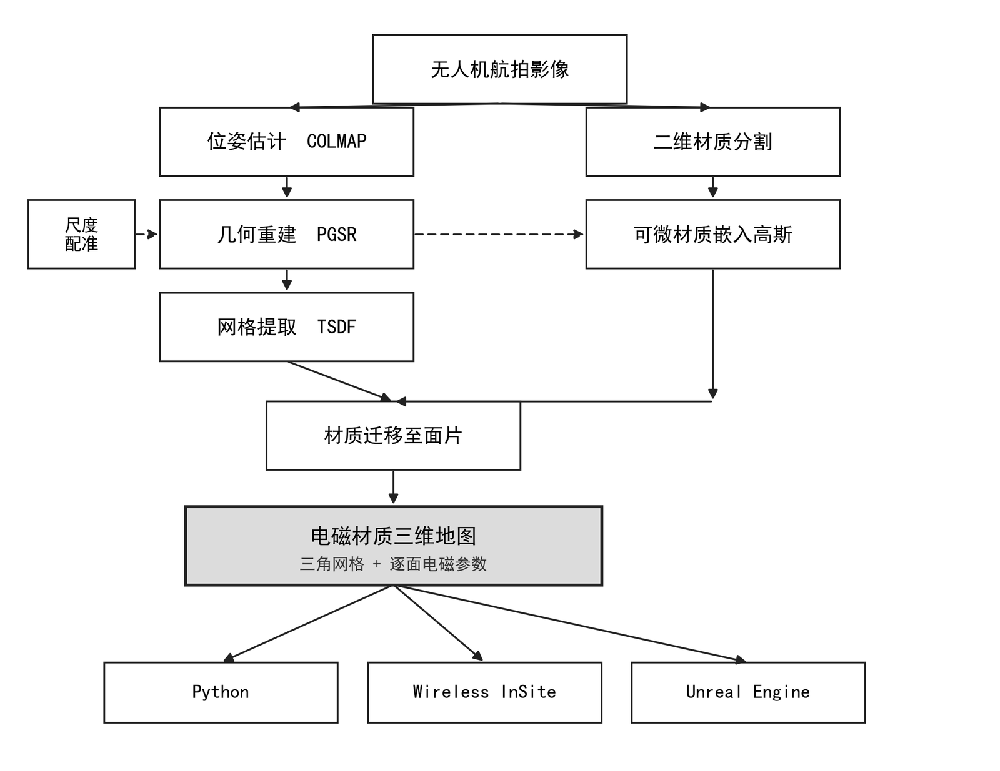
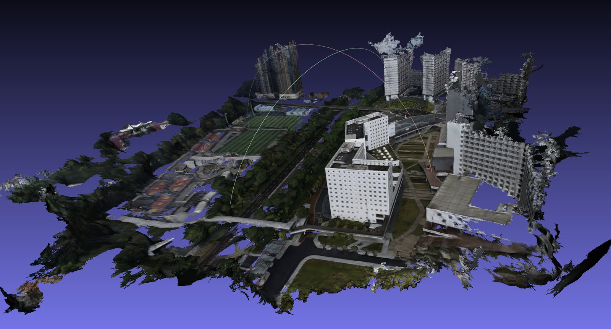
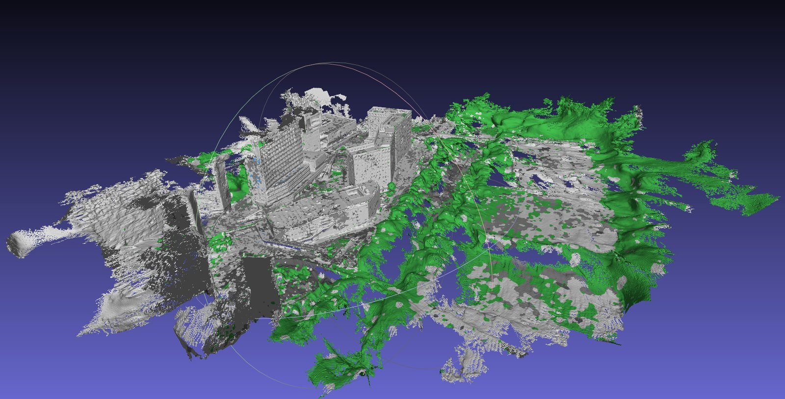
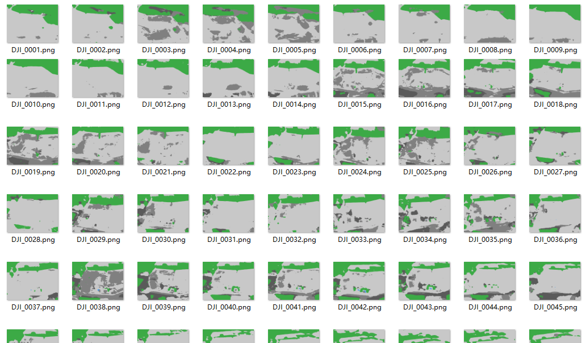
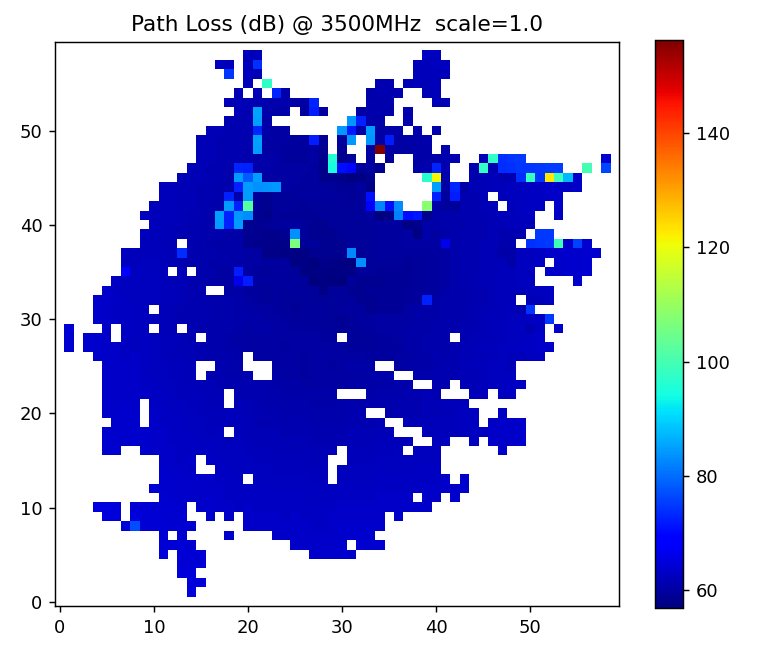
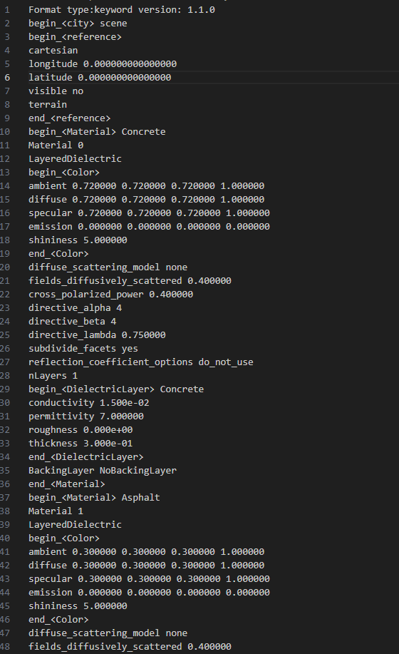
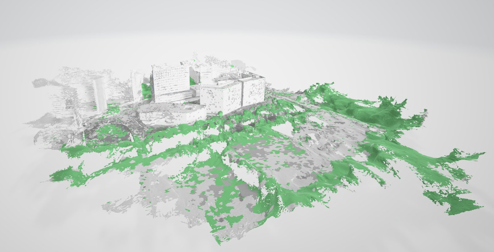

# lowalt3d — 无人机影像 → 材质感知 3DGS → 电磁三维地图 → 射线路损仿真

从无人机航拍照片出发，重建带**电磁材质属性**（ITU-R P.2040）的三维场景模型，
用于低空无线信道的射线追踪仿真：内置 Python 路损仿真器，并可一键导出
**Wireless InSite**（原生 `.city`，材质不丢）与 **Cesium for Unreal**（`.glb`）。

```
影像 → COLMAP 位姿 → PGSR(3DGS)训练 + TSDF 网格 → GPS 地理配准(米制+ENU)
     → 2D 材质掩码(SegFormer) + 窗户候选检测(GDINO+SAM)
     → 可微材质向量嵌入高斯(类别平衡 + 几何门 + L_cons) → 材质迁移到网格面片
     → 【材质裁决链】几何门 → 众数滤波 → 碎块过滤 → 凹坑判窗
     → P.2040 电磁参数 → 射线路损 / 3D 可视化 → 导出 InSite (.city) / UE (.glb)
```



## 成果一览（scene02：678 张航拍，RTX 5070 Ti）

| PGSR + TSDF 几何（PSNR 30.2，971 万面） | 材质地图（6 类 · P.2040） |
|---|---|
|  |  |

灰=concrete，绿=vegetation，蓝=glass，深灰=asphalt。玻璃经两级路由后从首轮 **2,640 面 → 34.2 万面**
（占比 0.04% → 3.7%），且水平面几乎无玻璃、墙面无椒盐。

| 2D 材质掩码（SegFormer + GDINO 窗候选） | Python 路损热力图（P.2040） |
|---|---|
|  |  |

**三个仿真器读同一份 `face_materials.csv`，材质均可识别：**

| Wireless InSite（`.city` 材质列表 `In Use=Yes`） | Cesium for Unreal（`.glb` + LineTrace） |
|---|---|
|  |  |

## 特性

- **可微材质学习**：把 K 维材质向量作为每高斯可学习参数，经 3DGS 渲染管线
  （`override_color` 通道，**无需改 CUDA**）投影到 2D 与分割掩码做 CE 监督。
  含类别平衡 + Focal CE（少数类 glass 不被 57% 的 concrete 淹没）、空间-颜色-法向平滑、
  跨视角重投影一致性 `L_cons`、以及训练侧**几何门**。
- **两级材质路由：检测=候选，几何=裁决**。零样本 2D 检测只"建议"哪里是窗，
  最终拍板的是**与场景统计无关的几何先验**（玻璃/金属只上竖直面、沥青/背景/植被只上水平面、
  真窗成片、窗是立面上的凹坑）。避免了"阈值驱动的检测即材质"换场景必误涂的通病。
- **地理配准**：无人机 GPS EXIF ↔ COLMAP 相机位姿做 Umeyama 相似变换，
  一次恢复米制尺度 + ENU 朝向（+Z 向上）。
- **仿真器直通**：
  - Wireless InSite：直写原生 `.city`（逐面片材质索引，绕过 COLLADA 导入丢材质的问题）；
  - Cesium for Unreal：`.glb` 按电磁类分材质槽 + 经纬高锚点 + C++ LineTrace 追踪器（`ue/`）；
  - Python：内置 P.2040 射线路损图（LoS/穿透损耗），三方结果可互相对比。

## 材质类别（v2，6 类）

`configs/classes.txt`：`background(0) / vegetation(1) / asphalt(2) / concrete(3) / glass(4) / metal(5)`

> ⚠️ **类别顺序是 load-bearing**，必须在**四处**完全一致：`configs/classes.txt`、
> `configs/radio_params.yaml`、`material_common.py::_DEFAULT_CLASS_ORDER`、`autolabel.py::_KEYWORDS`。
> 2D 掩码像素值就是这个顺序里的类别索引；不同步会让所有 `material_id` **整体错位且不报错**。
> `smooth_face_materials.py` / `label_windows_geom.py` 内置一致性 `assert`。

## 环境

| 项 | 要求 |
|---|---|
| OS | Windows 10/11（原生，无需 WSL） |
| GPU | NVIDIA（已验证 RTX 5070 Ti / Blackwell sm_120，16 GB） |
| Python | conda 环境，Python 3.10 + PyTorch 2.8 (cu128) |
| 编译 | VS 2022 (C++ 工具链) + CUDA Toolkit 12.8（编译 PGSR CUDA 扩展） |
| 依赖 | `numpy scipy opencv-python open3d pillow pycollada trimesh matplotlib pyyaml` |
| 可选 | `transformers`（SegFormer 分割 / GDINO+SAM 窗检测） |

第三方（不随仓库分发，放入下列目录）：

- `repos/pgsr` — [PGSR](https://github.com/zju3dv/PGSR) 克隆后按其说明编译子模块
  （Blackwell 显卡编译时 `set TORCH_CUDA_ARCH_LIST=12.0`，pip 安装子模块加 `--no-build-isolation`）；
- `tools/` — [COLMAP](https://github.com/colmap/colmap/releases) Windows-CUDA 预编译版解压于此。

## 快速开始

把无人机原图（保留 GPS EXIF）放到 `data\<场景名>\input\`，按下列步骤从上到下执行——
全流程已参数化，换场景只改一个 `SCENE` 变量。下面是 scene02（678 张）的实测配方。

```cmd
set SCENE=scene02
set TORCH_CUDA_ARCH_LIST=12.0

:: 1) COLMAP 位姿 + 去畸变（在 repos\pgsr 下；--data_path 用绝对路径给父目录）
python scripts\preprocess\convert.py --data_path E:\lowalt3d\data

:: 2) 预降采样（训练解码更快；-r 2 = 2436×1824）
python scripts\downscale_images.py --images data\%SCENE%\images --out data\%SCENE%\images_2 -r 2

:: 3) PGSR 训练（约 4.7 h）+ TSDF 出网格（在 repos\pgsr 下）
::    densification 参数一律【保持默认】——调它们会加重植被空洞
python train.py -s ..\..\data\%SCENE% -m ..\..\outputs\%SCENE%_pgsr_hq -i images_2 -r 2 ^
  --iterations 30000 --data_device cpu --save_iterations 7000 15000 30000 --test_iterations 99999
python render.py -m ..\..\outputs\%SCENE%_pgsr_hq -i images_2 -r 2 ^
  --max_depth 10.0 --voxel_size 0.01 --use_depth_filter

:: 4) 地理配准（GPS EXIF → 米制 + ENU）
python scripts\georeference.py --images data\%SCENE%\input ^
  --cameras outputs\%SCENE%_pgsr_hq\cameras.json --out outputs\%SCENE%_pgsr_hq\geo_transform.json

:: 5) 2D 材质掩码：SegFormer 基线 + 窗户候选（GDINO+SAM）
python scripts\autolabel.py --images data\%SCENE%\images_2 ^
  --out data\%SCENE%\material\masks_auto --classes configs\classes.txt --color
python scripts\detect_windows.py --images data\%SCENE%\images_2 ^
  --base_masks data\%SCENE%\material\masks_auto --out data\%SCENE%\material\masks_win ^
  --classes configs\classes.txt --box_threshold 0.15 --min_win_px 500 --sam

:: 6) 可微材质嵌入高斯（材质用 -r 4 即可，无需跟几何的 -r 2）
python scripts\train_gaussian_material.py -s data\%SCENE% -m outputs\%SCENE%_pgsr_hq ^
  -i images_2 -r 4 --load_iteration 30000 --masks_dir data\%SCENE%\material\masks_win ^
  --classes configs\classes.txt --mat_out outputs\%SCENE%_pgsr_hq\gaussian_material_cons ^
  --epochs 20 --focal_gamma 1.0 --lambda_smooth 0.5 --smooth_normal --lambda_cons 0.3 ^
  --lambda_gate 1.0 --gate_classes glass,metal --gate_ground_classes asphalt,background

:: 7) 材质迁移到网格面片（kNN 加权投票 + 法向一致度）
python scripts\gaussian_to_mesh_material.py --mesh outputs\%SCENE%_pgsr_hq\mesh\tsdf_fusion_post.ply ^
  --gaussian_ply outputs\%SCENE%_pgsr_hq\point_cloud\iteration_30000\point_cloud.ply ^
  --material_pt outputs\%SCENE%_pgsr_hq\gaussian_material_cons\gaussian_material.pt ^
  --classes configs\classes.txt --use_normal --out_dir outputs\%SCENE%_pgsr_hq\material_gauss_cons

:: 8) 材质裁决链（几何门 → 众数滤波 → 碎块过滤 → 凹坑判窗）★纯后处理，不重训
python scripts\smooth_face_materials.py --mesh outputs\%SCENE%_pgsr_hq\mesh\tsdf_fusion_post.ply ^
  --materials outputs\%SCENE%_pgsr_hq\material_gauss_cons\face_materials.csv ^
  --classes configs\classes.txt --out_dir outputs\%SCENE%_pgsr_hq\material_clean ^
  --k 12 --iters 2 --geo_gate --up_axis 2 ^
  --horiz_forbid glass,metal,vegetation --min_win_area 20 --drop_unlabeled metal
python scripts\label_windows_geom.py --mesh outputs\%SCENE%_pgsr_hq\mesh\tsdf_fusion_post.ply ^
  --materials outputs\%SCENE%_pgsr_hq\material_clean\face_materials.csv ^
  --classes configs\classes.txt --up_axis 2 --recess_min 0.01 --recess_max 0.06 ^
  --out_dir outputs\%SCENE%_pgsr_hq\material_win

:: 9) P.2040 射线路损 + 3D 可视化（--scale 取 geo_transform.json 里的实际值）
python scripts\simple_pathloss.py --mesh outputs\%SCENE%_pgsr_hq\mesh\tsdf_fusion_post.ply ^
  --materials outputs\%SCENE%_pgsr_hq\material_win\face_materials.csv ^
  --cameras outputs\%SCENE%_pgsr_hq\cameras.json --out_dir outputs\%SCENE%_pgsr_hq\pathloss ^
  --grid 80 --scale 33.06
python scripts\visualize_sim.py --mesh outputs\%SCENE%_pgsr_hq\material_win\material_mesh.ply ^
  --grid_npz outputs\%SCENE%_pgsr_hq\pathloss\pathloss_grid.npz ^
  --out_dir outputs\%SCENE%_pgsr_hq\viz3d --rays --show

:: 10) 导出 Wireless InSite（加载 scene.city，勿用 .dae）/ Cesium UE
python scripts\export_dae.py --mesh outputs\%SCENE%_pgsr_hq\mesh\tsdf_fusion_post.ply ^
  --materials outputs\%SCENE%_pgsr_hq\material_win\face_materials.csv ^
  --out_dir outputs\%SCENE%_pgsr_hq\insite --geo_transform outputs\%SCENE%_pgsr_hq\geo_transform.json ^
  --ground_z0 --target_faces 2000000
python scripts\export_gltf_ue.py --material_ply outputs\%SCENE%_pgsr_hq\material_win\material_mesh.ply ^
  --geo_transform outputs\%SCENE%_pgsr_hq\geo_transform.json ^
  --out_dir outputs\%SCENE%_pgsr_hq\ue --target_faces 300000

:: 11) 【展示用】带照片纹理 + PBR 的分块 glb（UE 渲染；上一步只有纯色材质槽，供 RF 用）
::     --images 必须是去畸变图（与 cameras.json 同一套）；降采样图会自动缩放内参
python scripts\export_textured_ue.py --mesh outputs\%SCENE%_pgsr_hq\mesh\tsdf_fusion_post.ply ^
  --materials outputs\%SCENE%_pgsr_hq\material_win\face_materials.csv ^
  --cameras outputs\%SCENE%_pgsr_hq\cameras.json --images data\%SCENE%\images_2 ^
  --geo_transform outputs\%SCENE%_pgsr_hq\geo_transform.json ^
  --out_dir outputs\%SCENE%_pgsr_hq\ue_textured --target_faces 2000000 --tile_m 100 --tex 4096
```

**UE 展示导出**（`export_textured_ue.py`，依赖 `pip install xatlas trimesh`）：按 ENU 米制分块 → xatlas 展 UV →
逐纹素投影到可见照片（Open3D 深度图判遮挡，按入射角/分辨率/离边缘距离加权融合）→ 每块输出
`tile.glb`（内嵌 BaseColor + metallicRoughness 贴图）、`basecolor.png`、`orm.png`、`material_id.png`、
`collision.glb`，以及 `tiles.json`。PBR 值按材质类查 `configs/visual_pbr.yaml`（**视觉参数，与 P.2040 电磁表无关**）。
所有块共用同一原点：UE 中 Uniform Scale 100 导入后全部放在世界原点即可拼合；开 Nanite；碰撞用 `collision.glb`。
`--selfcheck` 用合成场景验证投影/遮挡/uv 约定（颜色误差中位 < 1/255）。
已知局限：未做影像间曝光统一（色差大时会出现块状色斑）；植被/窗洞等网格空洞处没有纹理可贴。

> **下游一律用 `material_win`**（裁决链输出），不要用第 7 步未清理的 `material_gauss_cons`——
> 后者是原始票数，墙面有椒盐、屋顶有玻璃、metal 全是 argmax 噪声。

**大场景**：单次训练要靠 `--max_all_points` 等参数换显存（拿植被/薄结构完整度做代价）。
改用分块——`split_scene.py`（ENU 米制分块）→ 逐块 PGSR 训练 → `merge_blocks.py` 合回一份高斯 →
后续 TSDF/材质/导出链**完全不变**。**铁律：全局只做一次 SfM**，分块 COLMAP 的坐标系互不兼容、无法合并。

## 目录结构

| 路径 | 内容 |
|---|---|
| `scripts/` | 全部管线脚本（见下表） |
| `configs/` | `classes.txt` 材质类别、`radio_params.yaml` P.2040 电磁参数表 |
| `ue/` | UE C++ 射线追踪器 `RFRayTracer.{h,cpp}`（拷进 UE 工程的 `Source/`，不在此编译） |
| `data/` `outputs/` `experiments/` `docs/` | 场景输入/输出、实验归档、报告（不入库，运行时生成） |
| `repos/` `tools/` | PGSR / COLMAP（不入库，自行获取） |

## 脚本一览

| 脚本 | 作用 |
|---|---|
| **几何** | |
| `downscale_images.py` | 预降采样出 `images_N`（训练解码提速） |
| `clean_gaussians.py` | 高斯点云清理（NaN/离群/漂浮/低透明度，属性完整可读回） |
| `close_facade_holes.py` | 平面先验补洞（`fill_holes` + 去浮块），RF 安全 |
| `split_scene.py` / `merge_blocks.py` | 大场景分块训练 / 合并（VastGaussian 式，ENU 米制） |
| `georeference.py` | GPS EXIF 地理配准 → 米制尺度 + ENU 朝向 |
| **材质：2D 标注** | |
| `autolabel.py` | SegFormer(ADE20K) 自动预标注 → 基线掩码 |
| `detect_windows.py` | **GDINO(+SAM) 零样本窗户检测 → 玻璃候选**（航拍域唯一 work 的产 glass 标签法） |
| `train_seg.py` / `infer_seg.py` / `labelme2mask.py` | 人工标注微调 SegFormer（提召回的正路） |
| `eval_masks.py` | 掩码质量量化（各类 IoU / recall） |
| **材质：3D 学习与裁决** | |
| `train_gaussian_material.py` | 可微材质向量嵌入高斯（类别平衡+Focal、平滑、几何门、`L_cons`） |
| `gaussian_to_mesh_material.py` | 高斯材质 → 网格面片（不透明度×距离×法向 加权 kNN 投票） |
| `smooth_face_materials.py` | **几何门（体素多数）+ 众数滤波 + 碎块过滤**，清椒盐/伪金属 |
| `label_windows_geom.py` | **凹坑判窗**：竖直立面上回退的面 → glass（纯几何，补回真窗） |
| **仿真与导出** | |
| `simple_pathloss.py` | 材质 → P.2040 → 射线路损图（直射 + 穿透，暂无反射/绕射） |
| `visualize_sim.py` | 路损/视距/射线 3D 可视化 |
| `export_dae.py` | 导出 Wireless InSite `.city`/`.dae` + 材质表 |
| `export_gltf_ue.py` | 导出 Cesium/UE `.glb` + 材质槽 + 地理锚点 |
| `export_textured_ue.py` | 导出**带照片纹理 + PBR** 的分块 `.glb` + 碰撞网格（UE 视觉展示） |
| `compare_engines.py` | Python ↔ UE 覆盖结果对比（RMSE/相关系数） |
| `material_common.py` | 共用：类别表 / P.2040 电磁参数 / 调色板（**唯一真源**） |

> 所有脚本都是独立 argparse CLI，**从仓库根 `E:\lowalt3d` 运行**（PGSR 的 `train.py`/`render.py`/`convert.py`
> 例外，从 `repos\pgsr` 运行）。重几何库（torch/open3d/trimesh/cv2）在 `main()` 内导入，故 `--help` 很快。
> `smooth_face_materials.py` / `label_windows_geom.py` 带 `--selfcheck` 自检。

## 已知要点（踩过的坑）

**导出 / 仿真**
- **InSite 请加载 `scene.city`**：其 COLLADA 导入器会把多材质合并成单一材质，`.city` 为逐面片材质索引的原生格式；
- 模型躺平/尺寸不对 → 导出时加 `--geo_transform`；地面悬在 z≈−80 → 加 `--ground_z0`（纯平移，不影响路损）；
- `--target_faces` 抽面**不会丢材质类**（新面按最近原始面重投），但会磨平窗洞这类小几何；
  `0` = 不抽（9.7M 面 ≈ 1.7 GB 的 `.city`，InSite 基本吃不下），实用区间 200 万左右；
- InSite 日志 `Failed to load OptiX` = 该版对新架构显卡无 GPU 加速，降 Reflections 至 2、Ray spacing 至 1.0° 提速。

**单位 / 坐标**
- **COLMAP 单位不是米**：1 单位 = `geo_transform.json` 的 `scale`（scene02 = **33.06 m**）。
  `label_windows_geom` 的 `recess_min/max`、`smooth_face_materials` 的 `--gate_voxel` 都吃 COLMAP 单位——
  按"厘米"理解会漏掉大半真窗。**先跑一次看打印的 `recess 分位`再定阈值**；
- `simple_pathloss.py` 不传 `--scale` 时只有**相对**分布有意义，绝对 dB 不准。

**PGSR 训练**
- **显存要在 iteration 7000 之后判断**：两个几何正则在 7000 才启用，之前看着很省，之后断崖；
- OOM 的两种成因要用不同解法：高斯太多 → `split_scene.py` 分块；单图像素太多 → 降 `-r`。
  **别**用 `--opacity_cull_threshold` 调大 / `--max_abs_split_points 0` 去省显存——那是拿植被完整度换显存；
- `--preload_img` 在 `-r 2` + 678 张下会把内存撑爆，**别加**；`--ncc_scale` 是**除数**，保持 `1.0`；
- `convert.py` 保持 stock：放开特征数 + `spatial_matcher` 实测把 PSNR 从 30.2 降到 **28.8**。

**材质**
- **别用纯颜色/暗区规则产 glass 标签**（阴影、暗地面会被刷成玻璃，航拍上 recall≈0）；
- **别把低置信 2D 检测直接当硬 CE 目标**——`--box_threshold` 别低于 0.12，宁可漏检不可误涂；
- `--min_win_area` 别取太大：本网格**一个窗 ≈ 30–60 面**，取 50 会把"只涂到一半的窗"整块删掉（用 **20**）；
- metal 无 2D 标签（训练时类别权重为 0），残留面全是 argmax 噪声 → 用 `--drop_unlabeled metal` 清掉，
  否则等于在 RF 场景里**凭空造理想导体反射面**；
- 网格空洞是**采集缺口**（俯视航线没拍到建筑下部/窗洞内表面/植被背面），任何重建方法都填不出没拍到的表面。
  平面先验补洞（`close_facade_holes.py`）是 RF 安全的；**生成式补全（NeRFiller/GaussFiller）禁用**——
  对未观测内容做幻觉再拿去电磁仿真，是 correctness bug 而非画质问题。

## 许可与致谢

依赖并致谢开源项目 [PGSR](https://github.com/zju3dv/PGSR)、[COLMAP](https://colmap.github.io/)、
Open3D、pycollada、[Grounding DINO](https://github.com/IDEA-Research/GroundingDINO)、
[SAM](https://github.com/facebookresearch/segment-anything) 以及无人机数据集
[UrbanScene3D](https://github.com/Linxius/UrbanScene3D)。电磁参数取自 ITU-R P.2040 建议书。
