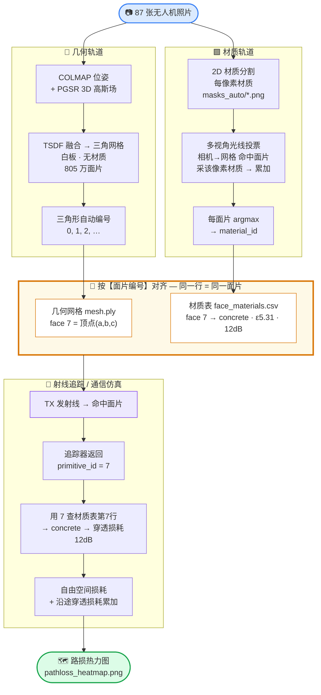
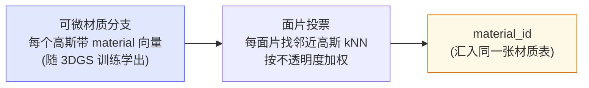

# 数据流图：高斯 → 网格 → 材质表 → 射线查表

> 用 marktext / Typora / Obsidian / VS Code(Mermaid插件) 打开本文件即渲染成图形。
> 回答"转成面片后，射线怎么知道那块网格是什么材质"。

## 核心机制

**几何(网格) 和 材质(表) 是两张按「面片编号」对齐的平行表。射线追踪只负责告诉你"命中第几号面片"，拿这个编号查材质表即得电磁参数。**

## 三个要点

1. **网格只存几何**（`mesh.ply` = 顶点+三角形），材质单独存在 `face_materials.csv`。
2. **面片编号是钥匙**：几何第 7 行 ↔ 材质第 7 行，同指 7 号三角形。
3. **射线追踪唯一贡献** = 返回"命中第几号面片"(`primitive_id`)，剩下全靠查表。

## 开题变体（可微材质，多一环）

我们当前"材质轨道"直接给面片投票；开题版先在高斯上学材质、再投票到面片：

两条路终点相同——都是填对那张"面片编号 → 材质"表；射线那边永远只是查表。
